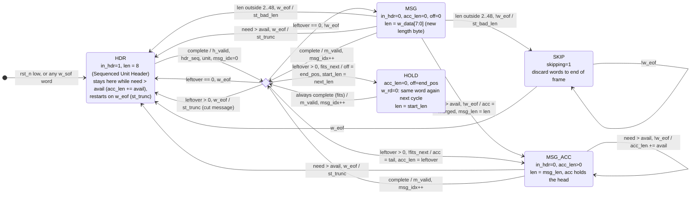
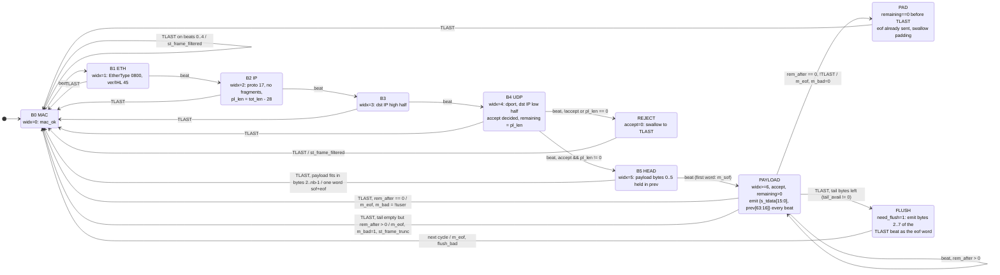
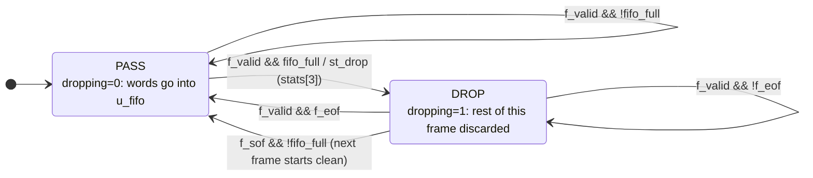
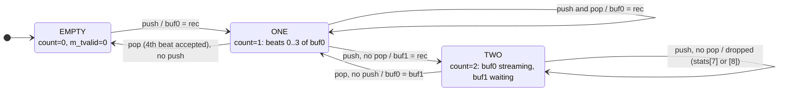
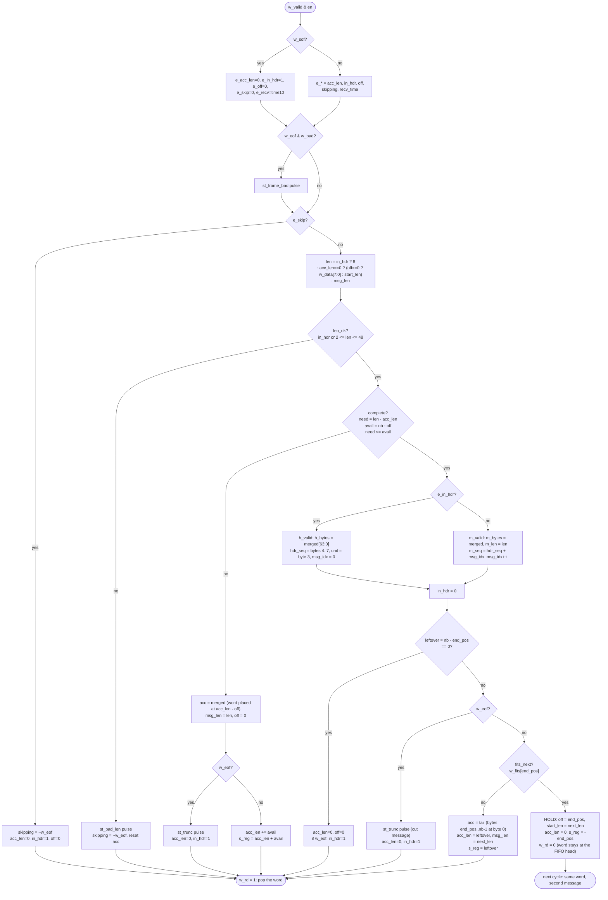
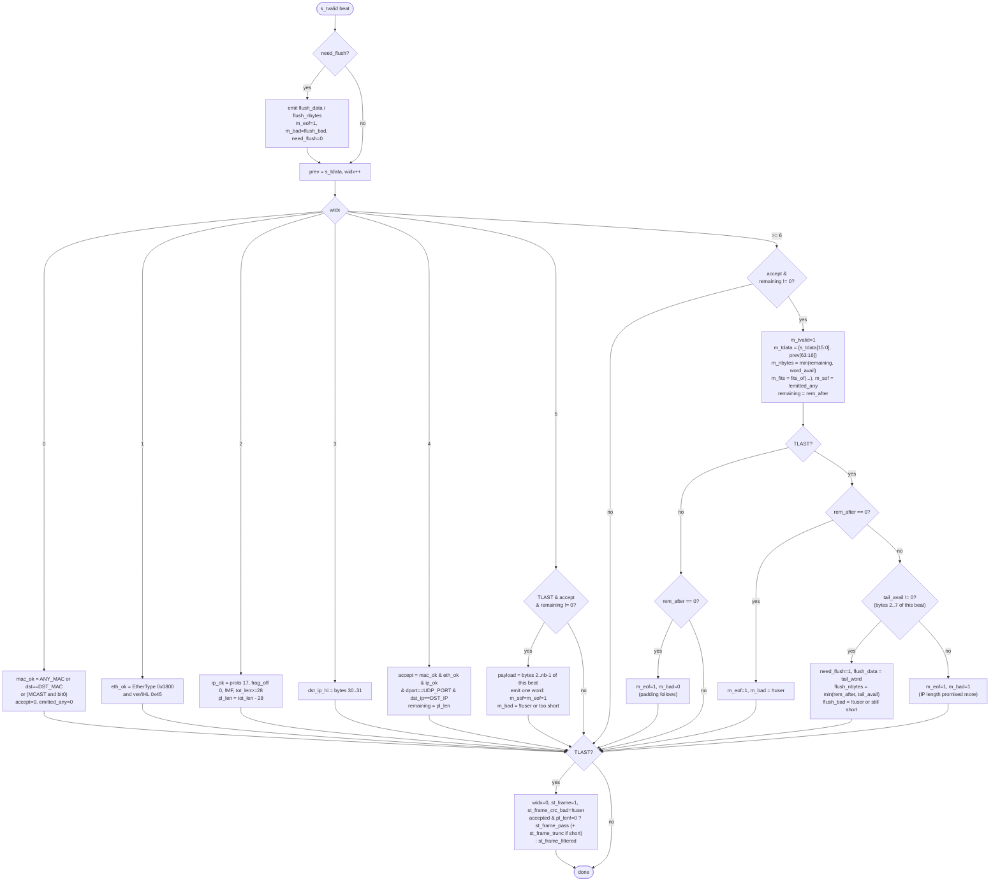
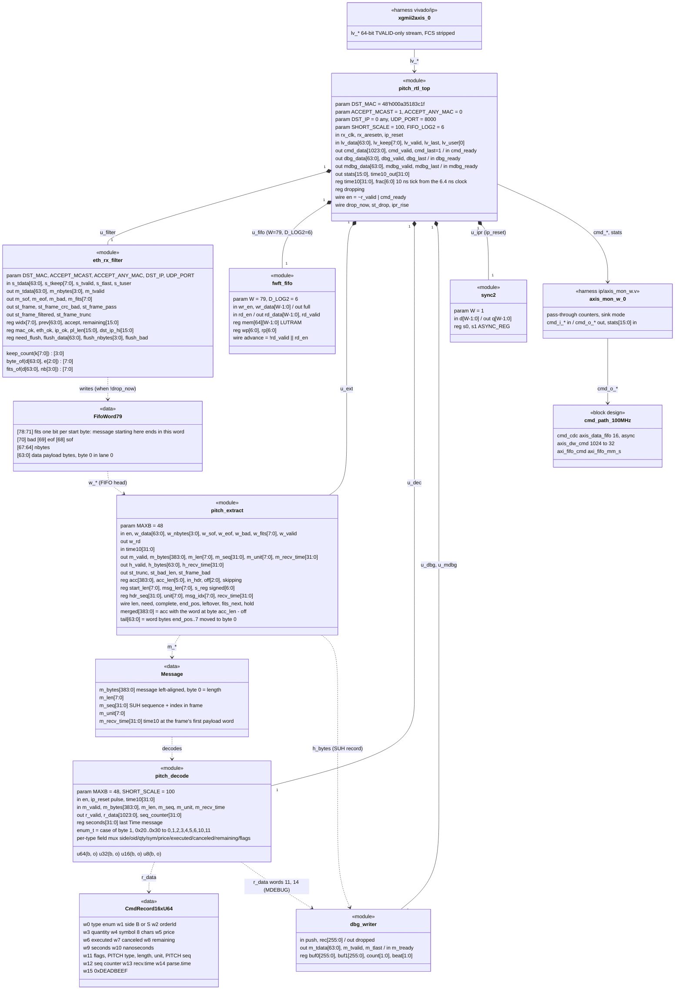

# vivado_rtl -- diagrams of the pure-RTL PITCH parser

Mermaid source for the parser in `ip/` (renders on GitHub, in VS Code with a Mermaid
extension, or at mermaid.live). Every box and transition below names the signal or
register in the Verilog it was drawn from, so the diagram and the code can be checked
against each other. All stages run in `rx_clk` (156.25 MHz, 6.4 ns) unless marked.

| Diagram | Source files |
|---------|--------------|
| 1. Data flow (flow chart, with the cycle budget) | `ip/pitch_rtl_top.v`, `mktdata_rtl.tcl` |
| 2. State machines: `pitch_extract`, `eth_rx_filter`, frame dropper, `dbg_writer` | `ip/pitch_extract.v`, `ip/eth_rx_filter.v`, `ip/pitch_rtl_top.v`, `ip/pitch_support.v` |
| 3. Per-word decision flow chart of `pitch_extract` and per-beat flow of `eth_rx_filter` | `ip/pitch_extract.v`, `ip/eth_rx_filter.v` |
| 4. UML class diagram of the modules and the records they pass | all of `ip/` |

## 1. Data flow: one 10G frame in, one 1024-bit record per message out

Latency after the last byte of a message lands on the `lv_` stream: filter 1 cycle (+1 flush
cycle for the last word of a frame), FIFO 2 cycles, extractor 1, decoder 1, so about 6 cycles
(40 ns). Measured on hardware: 0.81 us for the last message of a 1012-byte frame, which is
the frame's own arrival time at 10 Gbit/s (cut-through).

```mermaid
flowchart LR
    subgraph RX["rx_clk 156.25 MHz (6.4 ns), inside pitch_rtl_top unless noted"]
        direction LR
        X["xgmii2axis_0 (harness)<br/>lv_data[63:0] lv_keep lv_last<br/>lv_user[0] = FCS good, FCS stripped"]
        F["u_filter: eth_rx_filter<br/>MAC / EtherType / IPv4 / UDP checks<br/>re-align payload to byte lane 0<br/>fits_of() per word<br/>1 cycle (+1 flush at TLAST)"]
        DROP{"fifo_full<br/>or dropping?"}
        Q["u_fifo: fwft_fifo<br/>64 x 79 bits<br/>{fits[7:0], bad, eof, sof, nb[3:0], data[63:0]}<br/>2 cycles"]
        E["u_ext: pitch_extract<br/>1 word in, 1 message out, per cycle<br/>acc[383:0] left-aligned<br/>hold = second message ends in same word"]
        D["u_dec: pitch_decode<br/>type enum, per-type field mux<br/>r_data[1023:0] = 16 x U64<br/>1 cycle"]
        DBG["u_dbg: dbg_writer<br/>reset record + 1 per Sequenced Unit Header"]
        MDBG["u_mdbg: dbg_writer<br/>1 per record handed downstream"]
        MON["axis_mon_w_0<br/>records, seq gaps, stalls, latency<br/>sink mode = cmd_ready forced 1"]
        X -- "lv_* (TVALID only, no back-pressure)" --> F
        F -- "f_data f_nb f_sof f_eof f_bad f_fits" --> DROP
        DROP -- "yes: whole frame dropped<br/>st_drop (stats[3])" --> LOST(("frame lost"))
        DROP -- "no: wr_en" --> Q
        Q -- "w_* head, w_rd = go & ~hold" --> E
        E -- "m_bytes[383:0] m_len m_seq m_unit m_recv_time" --> D
        E -. "h_bytes per frame (SUH)" .-> DBG
        D -- "cmd_data cmd_valid, cmd_last = 1" --> MON
        D -. "cmd_hs: parse.time, len, type, PITCH seq" .-> MDBG
        D -. "en = ~r_valid | cmd_ready<br/>freezes u_ext and u_dec" .-> E
    end
    MON -- "cmd_o_*" --> CDC["cmd_cdc<br/>axis_data_fifo, 16 deep, async"]
    subgraph PL["pl_clk0 100 MHz"]
        CDC --> DW["axis_dw_cmd<br/>1024 -> 32 bits<br/>32 beats = 320 ns per record"]
        DW --> AF["axi_fifo_cmd<br/>axi_fifo_mm_s, AXI4-Lite 32-bit"]
    end
    AF -- "PIO read, ~8k records/s" --> PS["poc_server poll / serve<br/>Cortex-A53, Linux"]
    DBG --> DC["dbg_cdc -> axis_dw -> axi_fifo_dbg"]
    MDBG --> MC["mdbg_cdc -> axis_dw -> axi_fifo_mdbg"]
    STATS["stats[15:0] pulses<br/>0 pass 1 filtered 2 trunc 3 drop_full 4 hdr<br/>5 bad_len 6 msg_trunc 7 dbg_drop 8 mdbg_drop 9 crc_bad"] --> MON
```



## 2. State machines

### 2a. `pitch_extract` (ip/pitch_extract.v)

The state is spread over `in_hdr`, `acc_len`, `off` and `skipping`; the names below are
those register combinations. Every transition is taken on a valid word (`w_valid & en`).
A word with `w_sof` makes the stage behave as if it were in HDR regardless of the state
it is in (the `e_*` muxes), which is how a frame whose tail was dropped by the FIFO
guard, or that ended mid-message, is recovered from.



Signals used in the guards (all combinational from the FIFO head and the state):

```verilog
wire [3:0] avail    = nb - {1'b0, e_off};                       // bytes of this word still unused
wire [7:0] need     = len - {2'd0, e_acc_len};                  // bytes the message still needs
wire       complete = (need <= {4'd0, avail});                  // it ends inside this word
wire [3:0] end_pos  = {1'b0, e_off} + need[3:0];                // byte after it
wire [3:0] leftover = nb - end_pos;                             // bytes after it in this word
wire       fits_next = (end_pos < 4'd8) ? w_fits[end_pos[2:0]] : 1'b0;   // next one also ends here
wire hold = go & ~e_skip & len_ok & complete & (leftover != 4'd0) & ~w_eof & fits_next;
assign w_rd = go & ~hold;                                       // pitch_extract.v:85-127
```

### 2b. `eth_rx_filter` (ip/eth_rx_filter.v): one frame, beat by beat

The state is the beat index `widx` plus `accept`, `remaining` and `need_flush`. TLAST
returns to beat 0 from every state and fires the frame statistics.



### 2c. Frame dropper in `pitch_rtl_top` (never stalls the MAC)



`drop_now = f_valid & (f_sof ? fifo_full : (fifo_full | dropping))`. A frame cut mid-way
leaves no eof word in the FIFO; the next frame's `w_sof` word resets the extractor.

### 2d. `dbg_writer` (ip/pitch_support.v): two-entry record buffer, 4 beats per record



## 3. Flow charts

### 3a. `pitch_extract`: what happens to one word of the FIFO head



### 3b. `eth_rx_filter`: one input beat



## 4. UML class diagram: modules, instances and the records between them


